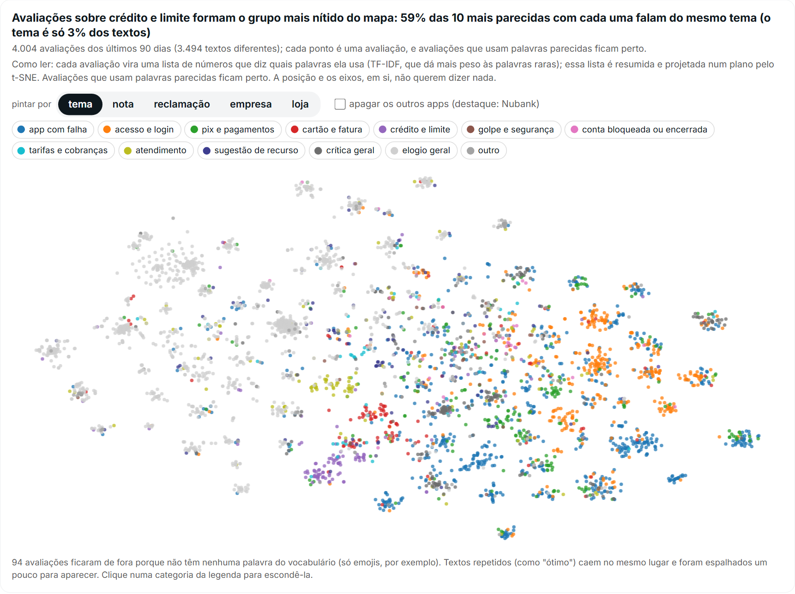
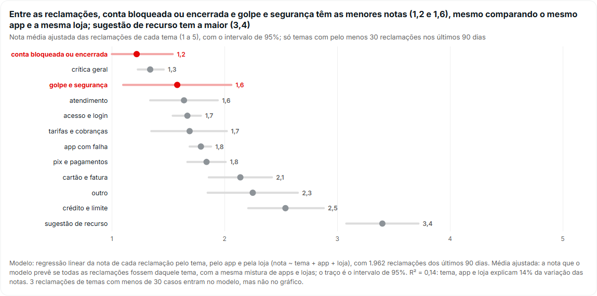

## Marketing Analítico com IA {.capa}

[{.claro} {.escuro}]{.logo}

::: {.curso}
Avaliações de aplicativos nas lojas
:::

Habilidades com código, coleta de dados da web, estruturação de textos e
painéis que se atualizam sozinhos

::: {.quando}
Julio Trecenti · terça-feira, 10 de novembro de 2026
:::

[]{.faixa}

## Quiz da aula

::: {.quiz-entrada}
{.qz-qr-img}
:::

::: {.miudo style="margin-top:.6rem"}
Aponte a câmera para o QR e escolha um apelido. Uma pergunta no fim de cada
parte da aula, sobre o que acabou de ser mostrado. Cada acerto vale de 1.000
pontos (resposta na hora) a 500 (no último segundo). Quem somar mais leva o
prêmio.
:::

## Aplicativos analisados

::: {.cena .cena-cheia data-cena="ap-apps"}
:::

::: {.legendas}
::: {}
O exemplo da aula: o que os clientes escrevem sobre **sete aplicativos**,
quatro bancos e três de delivery, na App Store e na Google Play.
:::
::: {}
Em cada cartão, a nota que a loja mostra na página e quantas notas ela soma.
São milhões de clientes, e milhares de avaliações escritas por semana.
:::
::: {}
A pergunta de negócio: **do que os clientes reclamam, em cada app, e isso
melhora ou piora?** Para responder, vamos baixar os textos, transformá-los em
colunas e montar um painel que se atualiza todo dia. Trocar de app é mudar uma
linha de uma planilha.
:::
:::

[]{.fragment .passo}
[]{.fragment .passo}

## Habilidades com código {.secao}

::: {.miudo}
Parte 1. Quando a IA precisa contar, somar ou baixar dados, a resposta tem de
sair igual toda vez.
:::

## Demonstração 1: contar menções num grupo focal {.exercicio-capa}

[Demonstração 1]{.ex-num}
[ChatGPT para computador, modo Work]{.chip .desktop} [pasta demos/1-contagem]{.chip .papel}

::: {.caixa .caso style="font-size:.74em"}
[O problema]{.rotulo}
Uma agência fez um **grupo focal** com oito viajantes frequentes para a Aérea
Sol, uma companhia aérea fictícia: quase duas horas de conversa, **916 falas**,
18 mil palavras. Antes de ler tudo, a diretoria quer saber: **quantas vezes
cada participante falou de preço?** Vamos perguntar ao ChatGPT do jeito
comum, em duas conversas novas, e depois com uma habilidade que conta com um
script.
:::

::: {.colunas style="margin-top:.5rem"}
::: {}
::: {.prompt .prompt-estruturado data-quem="Sem habilidade: duas conversas novas"}
Neste grupo focal (o arquivo anexo), quantas vezes cada participante falou de
preço?

Não conte a moderadora. Quero um número por pessoa e o total.
:::
:::
::: {}
::: {.prompt .prompt-estruturado data-quem="Com habilidade: uma conversa nova"}
Use a habilidade contar-termos.

Neste grupo focal (o arquivo anexo), quantas vezes cada participante falou de
preço?

Não conte a moderadora. Quero um número por pessoa e o total.
:::
:::
:::

::: {.miudo}
A entrevista está em `entrevista/grupo_focal_aerea_sol.txt`, uma fala por
linha (`NOME: texto`). A habilidade `contar-termos` já está instalada.
:::

## Contagens com e sem habilidade

::: {.cena data-cena="ap-grupo"}
:::

::: {.legendas}
::: {}
O que deu na preparação do curso de executivos, com a mesma transcrição e a
mesma pergunta. Compare com o que acabou de sair na demonstração.
:::
::: {}
**Sem habilidade**, três conversas, três totais. O modelo escreve uma palavra
de cada vez e, a cada conversa, escolhe um critério diferente (incluiu
reembolso, tirou reembolso, incluiu bagagem) e conta "de olho". Qual está
certo? Ninguém sabe.
:::
::: {}
**Com a habilidade**, o modelo não conta: ele roda um **script** que segue uma
lista de termos escrita. Dá 162 toda vez. E erra sempre igual ("filmando na
**cara**" entra como preço), mas o erro aparece nos trechos, e corrigir a lista
vale para sempre.
:::
:::

[]{.fragment .passo}
[]{.fragment .passo}

## Pergunta 1

::: {.quiz data-quiz="q1"}
:::

## Coleta de dados da web {.secao}

::: {.miudo}
Parte 2. Com uma habilidade pronta, baixar é um pedido. O cuidado passa a ser
outro: o que esses dados mostram, e o que não mostram.
:::

## Estrutura de uma habilidade

::: {.cena data-cena="ap-skill"}
:::

::: {.legendas}
::: {}
Uma habilidade é uma **pasta**. A única peça obrigatória é o `SKILL.md`, um
texto com instruções.
:::
::: {}
No alto do `SKILL.md`, o **nome e a descrição**. É só isso que o ChatGPT lê para
decidir se a habilidade serve para o seu pedido: escreva quando usar.
:::
::: {}
Depois, o **passo a passo** e as **regras**: o que fazer, em que ordem, e o que
nunca fazer. O modelo lê e decide (qual app, o que perguntar).
:::
::: {}
Em `scripts/`, o **código** que executa: baixa, conta, junta. O computador
roda, sempre igual. É o que torna a habilidade determinística.
:::
::: {}
E quantos **arquivos de apoio** forem úteis: documentação, exemplos, modelos de
relatório, listas de termos. O modelo só os abre quando precisa.
:::
::: {}
Na prática: o pedido chega, a descrição escolhe a habilidade, o `SKILL.md` guia,
o script executa. A habilidade completa está em `skills/avaliacoes-lojas/`.
:::
:::

[]{.fragment .passo}
[]{.fragment .passo}
[]{.fragment .passo}
[]{.fragment .passo}
[]{.fragment .passo}

## Demonstração 2: baixar as avaliações dos bancos {.exercicio-capa}

[Demonstração 2]{.ex-num}
[ChatGPT para computador, modo Work]{.chip .desktop} [conversa nova, com a habilidade avaliacoes-lojas instalada]{.chip .papel}

::: {.prompt .prompt-estruturado data-quem="Colar numa conversa nova (a habilidade avaliacoes-lojas já está instalada)"}
Use a habilidade avaliacoes-lojas para baixar as avaliações destes quatro
bancos:

- Nubank: App Store 814456780, Google Play com.nu.production
- Itaú: App Store 474505665, Google Play com.itau
- Banco do Brasil: App Store 330984271, Google Play br.com.bb.android
- Bradesco: App Store 336954985, Google Play com.bradesco

Junte tudo num arquivo só. Para cada banco e cada loja, me mostre numa tabela:
quantas avaliações vieram, de que data a que data, e a nota média das
avaliações escritas. Depois, ao lado, a nota que cada loja mostra na página do
app.
:::

::: {.miudo}
A App Store tem um feed público, feito para programas lerem: só as 500
avaliações mais recentes. A Google Play não tem: o pacote faz os mesmos pedidos
que a página faz, e as 500 mais recentes cobrem só dois a quatro dias num app
grande.
:::

## Demonstração 3 (opcional): criar uma habilidade com o skill creator {.exercicio-capa}

[Demonstração 3, se der tempo]{.ex-num}
[ChatGPT para computador, modo Work]{.chip .desktop} [conversa nova]{.chip .papel}

::: {.prompt .prompt-estruturado data-quem="Colar numa conversa nova. Ele leva alguns minutos: é a mesma habilidade da demonstração 2, feita do zero"}
Use o skill creator para criar uma habilidade chamada baixar-avaliacoes.

**Objetivo:** baixar as avaliações de um aplicativo na App Store e na Google
Play do Brasil, sempre do mesmo jeito, com um script em Python.

**Entrada:** o nome do app, o número dele na App Store e o pacote dele na
Google Play.

**Como baixar:** na App Store, o feed RSS em JSON (até 10 páginas de 50, as
mais recentes); na Google Play, o pacote google-play-scraper (as 500 mais
recentes).

**Regras:** uma página por vez, com pausa; guarde o arquivo bruto antes de
ler; nunca guarde o nome de quem avaliou; mascare telefone, e-mail e CPF.

**Saída:** um CSV (loja, app, id, data, nota, título, texto, versão) e um
resumo: quantas avaliações vieram de cada loja, de que data a que data e a
nota média.

**Teste:** com o Nubank (App Store 814456780, Google Play com.nu.production).
:::

## Nota da loja e nota das avaliações escritas

::: {.cena .cena-cheia data-cena="ap-notas"}
:::

::: {.legendas}
::: {}
O círculo vazio é a nota que a página da loja mostra: a média de milhões de
notas, a maioria sem texto.
:::
::: {}
O ponto vermelho é a média das avaliações **escritas** dos últimos 30 dias, as
que baixamos. Por que ele fica sempre à esquerda?
:::
:::

[]{.fragment .passo}

## Pergunta 2

::: {.quiz data-quiz="q2"}
:::

## Estruturação de textos {.secao}

::: {.miudo}
Parte 3. Ninguém lê milhares de avaliações por semana. Mas dá para fazer as
mesmas perguntas a cada uma, e transformar as respostas em colunas.
:::

## Avaliação como linha de tabela

::: {.cena .cena-cheia data-cena="ap-linha"}
:::

::: {.legendas}
::: {}
Uma avaliação real, como chegou da loja: 5 estrelas, mas reclamando.
:::
::: {}
Fazemos **as mesmas perguntas** a todas as avaliações: qual o tema principal?
Ela reclama de algo?
:::
::: {}
As respostas viram colunas. Com colunas, dá para contar, comparar apps e
acompanhar no tempo, como qualquer outra variável.
:::
::: {}
Cada resposta vem com a **confiança** do modelo. As de confiança baixa são as
que valem a pena ler.
:::
:::

[]{.fragment .passo}
[]{.fragment .passo}
[]{.fragment .passo}

## Dicionário de variáveis

::: {.colunas}
::: {.cena .ap-json data-cena="ap-json" style="flex:1.25"}
<pre class="cod" style="font-size:.62em;line-height:1.3">{"_instrucoes": "Você lê avaliações de aplicativos escritas
   por clientes na App Store ou na Play Store do Brasil.
   Responda a cada pergunta só com base no título e no
   texto da avaliação.",
 "variaveis": {
  "tema": {
   "pergunta": "Qual é o assunto principal da avaliação?",
   "tipo": "escolha",
   "opcoes": {
    "atraso na entrega": "o pedido demorou, atrasou ou nunca
       chegou, rastreamento errado",
    "cupons e promoções": "cupons, descontos, clube de
       assinatura, promoções que não funcionam", ...
    "elogio geral": "a avaliação elogia o app ou a empresa
       sem apontar um problema",
    "outro": "nenhuma das opções acima"}},
  "reclamacao": {
   "pergunta": "A avaliação reclama de alguma coisa (um
      problema, uma falha ou uma insatisfação)?",
   "tipo": "sim_nao"}}}</pre>
:::
::: {style="flex:.75"}
::: {.legendas}
::: {}
O **dicionário** é um arquivo (JSON) com as perguntas que vamos fazer a cada
avaliação. Ele fica na pasta, e não solto na conversa.
:::
::: {}
**As instruções gerais** valem para todas as perguntas: quem lê, de onde vêm os
textos, e a regra de ouro: responder só com o que está escrito.
:::
::: {}
**Cada variável** tem uma pergunta e um tipo. Aqui, `escolha`: a resposta é uma
opção de uma lista fechada. Sem lista, cada avaliação ganharia uma categoria
nova.
:::
::: {}
**Cada opção tem uma definição.** É o que o modelo lê para decidir, como
alguém novo na equipe leria um manual. No painel, bancos e delivery têm listas
diferentes.
:::
::: {}
**Opções para o que não é problema** ("elogio geral") e um **"outro"** para o que
não cabe em nenhuma. Sem elas, o modelo força o texto numa opção errada.
:::
::: {}
**Uma segunda variável**, do tipo sim ou não: a avaliação reclama de algo?
Cada variável vira uma coluna da tabela.
:::
:::
:::
:::

[]{.fragment .passo}
[]{.fragment .passo}
[]{.fragment .passo}
[]{.fragment .passo}
[]{.fragment .passo}

## Chamada ao Jev em Python

::: {.colunas}
::: {style="flex:1.6"}
<pre class="cod" style="font-size:.68em;line-height:1.3"># a chave fica no .env, nunca no código
from typesafe_sdk import AsyncTypeSafeClient
cli = AsyncTypeSafeClient(model="jev-latest")

perguntas = {
  "tema": {"type": "choice",
           "instructions": instrucoes + pergunta_tema,
           "criteria": opcoes["Delivery"]},
  "reclamacao": {"type": "noul",
                 "instructions": instrucoes + pergunta_rec},
}
avaliacao = {"titulo": "Dou apenas uma estrela.",
             "texto": "Cerveja quente, taxa de quase R$7,00"}

r = await cli.system_one(state=avaliacao, questions=perguntas)
r.answers["tema"].choice         # 'preços e taxas'
r.answers["tema"].probabilities  # {'preços e taxas': 0.99, ...}
r.answers["reclamacao"].noul     # 0.98 (sim)</pre>
:::
::: {style="flex:.6"}
O **Jev** é um modelo feito para responder perguntas tipadas: uma opção da
lista (`choice`) ou sim/não (`noul`).

::: {data-p="1"}
Ele não escreve texto. Devolve a resposta e **a probabilidade de cada opção**.
:::

::: {data-p="2"}
Rápido e barato: os [ ]{.dado data-k="n_textos_jev"} textos diferentes do painel foram anotados em
[ ]{.dado data-k="seg_jev"} segundos, 16 de cada vez. Cada resposta fica num cache: rodar de novo
não paga de novo.
:::
:::
:::

[]{.fragment .passo}
[]{.fragment .passo}

## Respostas do Jev com probabilidades

::: {.cena data-cena="ap-probs"}
:::

::: {.legendas}
::: {}
Avaliação do Itaú: o tema é claro (cartão e fatura, 98%), e ela reclama, mesmo
com 5 estrelas.
:::
::: {}
Zé Delivery: o texto fala de cerveja quente **e** de taxa. O Jev escolheu
preços e taxas com 99%: a pergunta pede **um** assunto principal.
:::
::: {}
iFood: "Praticidade e ótimos descontos" fica entre **elogio geral (55%)** e
**cupons e promoções (44%)**. O Jev não tem certeza, e diz isso.
:::
:::

[]{.fragment .passo}
[]{.fragment .passo}

## Teste em oito avaliações

::: {.cena data-cena="ap-teste"}
:::

::: {.legendas}
::: {}
Antes de rodar em milhares, rode em poucas e leia. Oito avaliações de
delivery, sorteadas: quatro com confiança alta, quatro com confiança baixa.
:::
::: {}
As de confiança abaixo de 60% são quase sempre textos com dois assuntos ou
opções mal definidas. Ajuste o dicionário e rode de novo. No painel,
[ ]{.dado data-k="conf_baixa"} temas ([ ]{.dado data-k="pct_conf_baixa"}) ficaram abaixo de 60%.
:::
:::

[]{.fragment .passo}

## Demonstração 4: anotar as avaliações com o Jev {.exercicio-capa}

[Demonstração 4]{.ex-num}
[ChatGPT para computador, modo Work]{.chip .desktop} [abra a pasta demos/4-anotar-com-jev]{.chip .papel}

::: {.prompt .prompt-estruturado data-quem="Colar numa conversa nova, com a pasta demos/4-anotar-com-jev aberta"}
Nesta pasta estão as avaliações recentes do iFood, do Rappi e do Zé Delivery
(avaliacoes_delivery.csv) e um dicionário de variáveis (dicionario.json).

Anote cada avaliação com o Jev: o tema principal (uma das opções do
dicionário) e se ela reclama de algo, com a probabilidade de cada resposta.
Como chamar o Jev está em como_usar_o_jev.md; a chave JEV_API_KEY está no .env
(não mostre a chave).

Teste em 10 avaliações para conferir que a chamada funciona e, sem esperar
por mim, rode em todas.

No fim: (1) salve um Excel (avaliacoes_anotadas.xlsx) com uma linha por
avaliação: as colunas originais, o tema, a confiança do tema, a segunda opção
mais provável e se reclama; (2) me mostre um gráfico de barras ordenadas com o
tema das reclamações de cada app, com a conclusão no título; (3) me mostre as
5 avaliações com a confiança mais baixa no tema, com as duas opções mais
prováveis.
:::

::: {.miudo}
A pasta já tem as 600 avaliações (100 por app e loja), o dicionário, um guia
curto de como chamar o Jev em Python e o `.env` com a chave, que nunca entra na
conversa nem vai para o GitHub. No fim, abra o `avaliacoes_anotadas.xlsx`: o
texto livre virou colunas.
:::

## Pergunta 3

::: {.quiz data-quiz="q3"}
:::

## Temas das reclamações por aplicativo

::: {.cena .cena-cheia data-cena="ap-temas"}
:::

::: {.legendas}
::: {}
Com as colunas prontas, a conta é simples: entre as avaliações que reclamam,
nos últimos 90 dias, a porcentagem de cada tema. Em vermelho, o tema número 1
de cada app.
:::
::: {}
[ ]{.dado data-k="leg_temas_bancos"}
:::
::: {}
[ ]{.dado data-k="leg_temas_delivery"}
:::
:::

[]{.fragment .passo}
[]{.fragment .passo}

## Painéis online com atualização diária {.secao}

::: {.miudo}
Parte 4. Uma conversa responde uma vez. Um processo responde todo dia, igual,
e avisa quando algo está errado.
:::

## Pasta de projeto e habilidade

::: {.cena data-cena="rs-pasta-skill"}
:::

::: {.legendas}
::: {}
Numa conversa, as regras que você combinou somem quando ela acaba. Numa pasta,
ficam escritas (`AGENTS.md`), e os passos ficam em arquivos.
:::
::: {}
Pense numa cozinha. A **pasta** é a cozinha desta unidade: a despensa e o
caderno de anotações. A **habilidade** é a ficha técnica do prato, que vai
para outra unidade.
:::
::: {}
**Fica na pasta** o que é deste caso e muda todo dia: as coletas, os temas
destes apps, o histórico de alertas e o painel de hoje.
:::
::: {}
**Vai na habilidade** o que vale para qualquer caso: os passos na ordem, os
scripts, as checagens genéricas e a descrição de quando usar.
:::
::: {}
**Primeiro a pasta, depois a habilidade:** rode de verdade algumas vezes, até
as regras pararem de mudar. Só então vale empacotar.
:::
:::

[]{.fragment .passo}
[]{.fragment .passo}
[]{.fragment .passo}
[]{.fragment .passo}

## Passos e checagens do monitor

::: {.cena .cena-cheia data-cena="ap-portoes"}
:::

::: {.legendas}
::: {}
O monitor deste painel tem seis passos, cada um num arquivo, sempre na mesma
ordem. `python monitor/rodar.py` roda todos.
:::
::: {}
Antes de qualquer número, as **checagens**: frases que precisam ser verdade
nos dados.
:::
::: {}
Umas só **alertam**: o painel sai, com um aviso.
:::
::: {}
Outras **bloqueiam**: se falharem, o painel de ontem continua no ar, e ninguém
vê um número errado.
:::
:::

[]{.fragment .passo}
[]{.fragment .passo}
[]{.fragment .passo}

## Checagens de qualidade do painel

::: {.cena data-cena="ap-checagens"}
:::

::: {.miudo data-p="1" style="margin-top:1rem"}
Uma checagem boa é uma frase que um gerente entende e que o código consegue
testar. Na dúvida entre alertar e bloquear: bloqueie o que pode **expor
alguém** ou **inverter uma conclusão**.
:::

[]{.fragment .passo}

## Pergunta 4

::: {.quiz data-quiz="q4"}
:::

## Páginas estáticas e dinâmicas

::: {.cena data-cena="rs-arquitetura"}
:::

::: {.legendas}
::: {}
Uma página **estática** é um arquivo pronto: abre rápido, não tem servidor, e
publicar é copiar o arquivo. O painel é assim.
:::
::: {}
O Python coleta, confere, anota e calcula **só os agregados**, num arquivo
`dados.json`.
:::
::: {}
A página recebe os números prontos e desenha os gráficos (ECharts).
:::
::: {}
Uma página **dinâmica** tem um servidor que calcula a cada visita: mais poder,
e mais coisa para manter (custo, login, alguém de TI).
:::
:::

[]{.fragment .passo}
[]{.fragment .passo}
[]{.fragment .passo}

## Atualização diária com o GitHub Actions

::: {.cena .cena-cheia data-cena="ap-acoes"}
:::

::: {.legendas}
::: {}
O arquivo `.github/workflows/atualizar.yml` diz **quando** e **o quê**: todo
dia às 9h, ou quando alguém aperta o botão "Run workflow".
:::
::: {}
Um servidor do GitHub liga, instala o Python e roda `monitor/rodar.py`.
:::
::: {}
Se uma checagem que bloqueia falhar, ele para ali, e o painel de ontem fica.
:::
::: {}
Se tudo passar, ele grava os dados novos no repositório, e o GitHub Pages
publica o painel.
:::
::: {}
A chave do Jev fica nos **segredos** do repositório, e nunca no código.
:::
:::

[]{.fragment .passo}
[]{.fragment .passo}
[]{.fragment .passo}
[]{.fragment .passo}

## Mapa das avaliações

::: {.colunas}
::: {style="flex:1.35"}
{style="max-height:520px;border-radius:10px;box-shadow:0 4px 18px rgba(0,0,0,.15)"}
:::
::: {style="flex:.65;font-size:.82em"}
Um modelo dentro do painel, recalculado a cada atualização, sem chave de API.

::: {data-p="1"}
**1. Texto vira vetor.** Cada avaliação vira uma lista de números: o peso de
cada palavra que ela usa (TF-IDF).
:::
::: {data-p="2"}
**2. Vetor vira ponto.** O t-SNE projeta esses vetores num plano, mantendo
perto o que é parecido.
:::
::: {data-p="3"}
**3. A cor vem do Jev.** Pinte por tema, nota, reclamação ou app, e veja onde
cada assunto se concentra. Passe o mouse para ler a avaliação.
:::
:::
:::

[]{.fragment .passo}
[]{.fragment .passo}
[]{.fragment .passo}

## Regressão da nota por tema

::: {.colunas}
::: {style="flex:1.35"}
{style="max-height:520px;border-radius:10px;box-shadow:0 4px 18px rgba(0,0,0,.15)"}
:::
::: {style="flex:.65;font-size:.82em"}
Entre as avaliações que reclamam: **que tema puxa mais a nota para baixo?**

::: {data-p="1"}
Uma **regressão linear**: a nota explicada pelo tema, pelo app e pela loja.
Assim, comparamos temas dentro do mesmo app e da mesma loja.
:::
::: {data-p="2"}
Cada ponto é a nota média prevista para o tema, com o intervalo de 95%. As
colunas que o Jev criou viram variáveis de um modelo, como qualquer outra.
:::
:::
:::

[]{.fragment .passo}
[]{.fragment .passo}

## Painel de exemplo

::: {.colunas}
::: {}
[{style="max-height:470px;border-radius:10px;box-shadow:0 6px 24px rgba(0,0,0,.18)"}](https://jtrecenti.github.io/avaliacoes-apps/painel/){target="_blank"}
:::
::: {style="font-size:.78em"}
**O painel**
[jtrecenti.github.io/avaliacoes-apps/painel](https://jtrecenti.github.io/avaliacoes-apps/painel/){target="_blank"}

**O botão de atualizar**
[Actions → Atualizar painel → Run workflow](https://github.com/jtrecenti/avaliacoes-apps/actions){target="_blank"}

**O código**
[github.com/jtrecenti/avaliacoes-apps](https://github.com/jtrecenti/avaliacoes-apps){target="_blank"}

::: {.miudo}
Vamos apertar o botão agora. Em poucos minutos, a coleta de hoje entra no
painel, com as checagens no fim da página.
:::
:::
:::

## Pergunta 5

::: {.quiz data-quiz="q5"}
:::

## Pedido para montar o painel

::: {.prompt .prompt-estruturado data-quem="Para levar: o pedido de um monitor com painel, para colar no ChatGPT, no Claude ou no Codex" style="font-size:.74em"}
Esta pasta vai ser um monitor diário das avaliações de [APPS] na App Store e na
Google Play.

**Projeto:** um passo por arquivo (coletar, juntar, checar, anotar, modelos,
painel), um `rodar.py`, um `README.md` e um `AGENTS.md` com as regras.

**Dados:** cada coleta fica guardada e nunca é editada; a mesma avaliação conta
uma vez; diga quantas linhas entraram e saíram em cada passo; nada de nome de
quem avaliou.

**Checagens:** antes de qualquer número, frases que precisam ser verdade; umas
bloqueiam, outras alertam.

**Textos e modelos:** anote o tema e a reclamação com o Jev, com cache; faça um
mapa das avaliações (TF-IDF e t-SNE, pintado pelas colunas do Jev) e uma
regressão da nota pelo tema, controlando por app e loja.

**Painel:** o Python calcula só agregados num `dados.json`; a página estática
desenha com ECharts, com a conclusão no título de cada gráfico.

**Atualização:** um GitHub Actions que roda tudo todo dia e publica no GitHub
Pages, com a chave nos segredos do repositório.
:::

## Placar final

::: {.quiz-placar data-final=""}
:::

## Resumo da aula

::: {.cartoes-n style="--n:2;font-size:1em"}
::: {.c1 data-p="1"}
**Habilidades com código.** Peça à IA para escrever o código que conta e
baixa, e guarde o código e o passo a passo numa habilidade.
:::
::: {.c2 data-p="2"}
**Coleta de dados da web.** Procure o feed ou o pacote antes de raspar, e
desconfie da amostra: quem escreve não é o cliente médio.
:::
::: {.c3 data-p="3"}
**Estruturação de textos.** Um dicionário com lista fechada, um teste em
poucas avaliações, e leitura das de confiança baixa.
:::
::: {.c4 data-p="4"}
**Painéis com atualização.** Passos em arquivos, checagens antes dos números,
e um robô que roda e publica todo dia.
:::
:::

[]{.fragment .passo}
[]{.fragment .passo}
[]{.fragment .passo}
[]{.fragment .passo}

## Como estes slides foram feitos {.secao}

::: {.miudo}
Tudo aqui é texto e código aberto, num repositório público.
:::

## Quarto e GSAP

::: {.colunas}
::: {data-p="1"}
**Quarto + reveal.js**

Cada slide é um título `##` num arquivo de texto (`slides/index.qmd`). O
Quarto transforma o arquivo numa apresentação reveal.js: uma página HTML só,
que abre em qualquer navegador.

<pre class="cod">## Temas das reclamações por aplicativo

::: {.cena data-cena="ap-temas"}
:::

[]{.fragment .passo}</pre>
:::
::: {data-p="2"}
**GSAP para as animações**

Cada `[]{.fragment .passo}` é um passo. Um pequeno motor conta quantos passos
estão visíveis e redesenha a cena a partir desse número, com o GSAP. Voltar um
slide nunca deixa a animação pela metade.

Os gráficos das cenas são SVG desenhado em JavaScript, com os números que um
script em Python escreve a partir dos dados reais.
:::
:::

[]{.fragment .passo}
[]{.fragment .passo}

## Ferramentas e links

::: {.cartoes-n style="--n:3;font-size:.92em"}
::: {.c1}
**Os slides**
[Quarto](https://quarto.org/docs/presentations/revealjs/){target="_blank"},
[reveal.js](https://revealjs.com){target="_blank"} e
[GSAP](https://gsap.com){target="_blank"}. Escritos junto com um agente de IA
(Claude Code), a partir dos materiais do curso de executivos.
:::
::: {.c2}
**O quiz**
Uma página estática que conversa com o
[Firebase Realtime Database](https://firebase.google.com/docs/database/rest/start){target="_blank"}:
o celular grava a resposta, o banco carimba a hora, o telão calcula os pontos.
:::
::: {.c3}
**O painel**
[ECharts](https://echarts.apache.org){target="_blank"},
[scikit-learn](https://scikit-learn.org){target="_blank"} (TF-IDF e t-SNE) e
[statsmodels](https://www.statsmodels.org){target="_blank"}, atualizado pelo
[GitHub Actions](https://docs.github.com/actions){target="_blank"} e publicado
no [GitHub Pages](https://pages.github.com){target="_blank"}.
:::
:::

::: {.colunas style="margin-top:1rem;align-items:center"}
::: {style="flex:0 0 190px"}
{style="width:180px;background:#fff;padding:8px;border-radius:10px"}
:::
::: {style="font-size:.8em"}
**Tudo está em**
[github.com/jtrecenti/avaliacoes-apps](https://github.com/jtrecenti/avaliacoes-apps){target="_blank"}:
os slides, o quiz, a habilidade, o monitor, as checagens e o painel.

**As demonstrações** (pedidos prontos, a entrevista, a habilidade de contagem e
os dados): [demos.zip](https://jtrecenti.github.io/avaliacoes-apps/materiais/demos.zip){target="_blank"}.
Para a demonstração 4, crie um `.env` com a sua `JEV_API_KEY`.
:::
:::

## Marketing Analítico com IA {.capa}

[{.claro} {.escuro}]{.logo}

::: {.curso}
Obrigado!
:::

Slides, quiz, habilidade, monitor e painel: github.com/jtrecenti/avaliacoes-apps

::: {.quando}
Julio Trecenti
:::

[]{.faixa}
