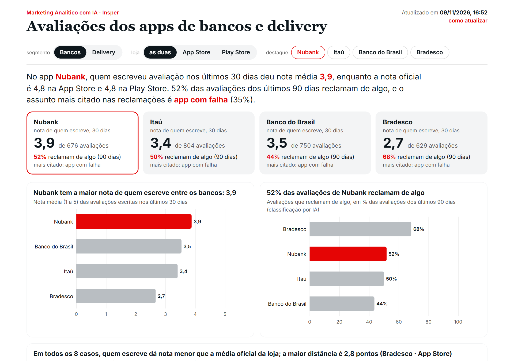

## Avaliações de aplicativos com IA: coletar, analisar e publicar {.capa}

[{.claro} {.escuro}]{.logo}

::: {.curso}
Marketing analítico
:::

Habilidades com código, textos que viram tabela e um painel que se atualiza sozinho

::: {.quando}
Julio Trecenti · terça-feira, 10 de novembro de 2026
:::

[]{.faixa}

## Entre no quiz: oito perguntas, e quem acerta mais rápido ganha

::: {.quiz-entrada}
{.qz-qr-img}
:::

::: {.miudo style="margin-top:.6rem"}
Aponte a câmera para o QR e escolha um apelido. Cada acerto vale de 1.000
pontos (na hora) a 500 (no último segundo). No fim da aula, o primeiro lugar
leva o prêmio.
:::

## O caso de hoje: o que os clientes escrevem sobre sete aplicativos

::: {.cena .cena-cheia data-cena="ap-apps"}
:::

::: {.legendas}
::: {}
Quatro bancos e três aplicativos de delivery, entre os mais baixados do país.
:::
::: {}
Nas duas lojas, App Store e Google Play, com as avaliações mais recentes de
cada aplicativo.
:::
::: {}
**A pergunta de negócio:** do que os clientes reclamam, e isso está
melhorando ou piorando? A resposta sai das próprias lojas, todo dia.
:::
:::

[]{.fragment .passo}
[]{.fragment .passo}

## O roteiro da aula: do texto solto ao painel que se atualiza

::: {.cartoes-n style="--n:4;font-size:.95em"}
::: {.c1 data-p="1"}
**1. Habilidades com código**
Por que a IA erra conta e como uma skill com um script resolve.
:::
::: {.c2 data-p="2"}
**2. Coletar textos da web**
As duas lojas, o jeito educado de baixar e o que os dados escondem.
:::
::: {.c3 data-p="3"}
**3. Texto vira tabela**
Um dicionário de perguntas, um modelo que responde com a confiança.
:::
::: {.c4 data-p="4"}
**4. Painel com checagens**
Um processo que roda sozinho e não publica dado errado.
:::
:::

[]{.fragment .passo}
[]{.fragment .passo}
[]{.fragment .passo}
[]{.fragment .passo}

## Habilidades com código {.secao}

::: {.miudo}
Quando a IA precisa contar, somar ou baixar, a resposta não pode mudar a cada
conversa.
:::

## Pergunta 1

::: {.quiz data-quiz="q1"}
:::

## O modelo sorteia cada palavra; o script segue uma receita

::: {.cena .cena-cheia data-cena="a1-palavra"}
:::

::: {.legendas}
::: {}
No curso de executivos, a pergunta era: quantas vezes o Diego falou de preço
num grupo focal de 916 falas?
:::
::: {}
O modelo escreve **uma palavra de cada vez**. Para a próxima palavra, há
várias candidatas, cada uma com uma chance.
:::
::: {}
E ele **sorteia** entre elas. Três conversas, três sorteios: 13, 12 e 25.
:::
::: {}
O script não sorteia: segue uma **receita**, linha por linha, nas 916 falas.
:::
::: {}
Mesma receita, mesmo resultado: **5**, toda vez. O script **conta**; o modelo
**interpreta**.
:::
:::

[]{.fragment .passo}
[]{.fragment .passo}
[]{.fragment .passo}
[]{.fragment .passo}

## Uma habilidade é um passo a passo escrito, e pode levar um script junto

::: {.cena data-cena="rs-skill"}
:::

::: {.legendas}
::: {}
**Habilidade (skill):** um passo a passo que o ChatGPT segue sempre igual.
:::
::: {}
Sem a habilidade, a conversa conta "de cabeça". Cada vez sai um número
diferente, e ninguém sabe qual está certo.
:::
::: {}
Com a habilidade, o `SKILL.md` diz o que fazer, e o script em Python faz a
conta.
:::
::: {}
**No marketing:** contar menções, baixar avaliações, conferir uma planilha,
qualquer tarefa que precisa sair igual toda vez.
:::
:::

[]{.fragment .passo}
[]{.fragment .passo}
[]{.fragment .passo}

## Instrução serve para julgar; script serve para contar

::: {.cena .cena-cheia data-cena="a1-fluxo"}
:::

::: {.legendas}
::: {}
A habilidade divide o trabalho em duas partes.
:::
::: {}
**Instrução** (o `SKILL.md`): o modelo lê e decide. Que termos usar, o que
perguntar antes de começar.
:::
::: {}
**Script**: o computador executa. A mesma conta, sempre o mesmo número. Bom
para contar, somar, filtrar, baixar, achar duplicata.
:::
::: {}
De volta ao modelo, que **interpreta** o resultado e aponta o que o script
contou errado.
:::
::: {}
**Mesmo número não é número certo.** O script erra igual toda vez, mas o erro
fica visível, e corrigir a regra vale para sempre.
:::
:::

[]{.fragment .passo}
[]{.fragment .passo}
[]{.fragment .passo}
[]{.fragment .passo}

## Um bom pedido de habilidade diz o objetivo, a entrada, as regras e a saída

::: {.cartoes-n style="--n:4;font-size:.95em"}
::: {.c1 data-p="1"}
**Objetivo**
O que a habilidade faz, num nome que diz o que faz: `avaliacoes-lojas`.
:::
::: {.c2 data-p="2"}
**Entrada**
O que você entrega: o nome do app e os identificadores nas duas lojas.
:::
::: {.c3 data-p="3"}
**Regras**
O que não pode mudar: uma página por vez, sem nome de quem avaliou, telefone
mascarado.
:::
::: {.c4 data-p="4"}
**Saída e teste**
O arquivo e o resumo que você vai conferir, e um caso real para testar.
:::
:::

::: {.miudo data-p="5"}
Dica: peça para ele **fazer perguntas** antes de escrever o `SKILL.md`. A
primeira versão quase nunca é a última: rode, confira, corrija a regra.
:::

[]{.fragment .passo}
[]{.fragment .passo}
[]{.fragment .passo}
[]{.fragment .passo}
[]{.fragment .passo}

## Demonstração 1: uma habilidade que baixa avaliações {.exercicio-capa}

[Demonstração 1]{.ex-num}
[ChatGPT, modo Work]{.chip .desktop} [o professor cola, a turma acompanha]{.chip .papel}

::: {.prompt .prompt-estruturado data-quem="O pedido, colado numa conversa nova"}
Crie uma habilidade chamada `avaliacoes-lojas` que baixa as avaliações de um
aplicativo na App Store e na Google Play do Brasil, sempre do mesmo jeito, com
um script em Python. **Entrada:** o nome do app, o número dele na App Store e o
pacote na Play Store. **Como:** na App Store, o feed RSS em JSON (até 10
páginas de 50, as mais recentes); na Play Store, o pacote `google-play-scraper`
(as 500 mais recentes). **Regras:** uma página por vez, com pausa; guarde o
arquivo bruto antes de ler; nunca guarde o nome de quem avaliou; mascare
telefone, e-mail e CPF. **Saída:** um CSV (loja, app, id, data, nota, título,
texto, versão) e um resumo: quantas vieram de cada loja, de que data a que data
e a nota média. **Teste** com o Nubank (814456780 e `com.nu.production`).
:::

## Coletar textos da web {.secao}

::: {.miudo}
Antes de raspar, procure o jeito mais simples. E desconfie do que os dados não
mostram.
:::

## Antes de raspar, procure um jeito mais simples

::: {.sub}
Os tipos de problema, do mais fácil para o mais difícil.
:::

::: {.cena data-cena="a2-escada"}
:::

[]{.fragment .passo}
[]{.fragment .passo}
[]{.fragment .passo}
[]{.fragment .passo}

## As duas lojas entregam as avaliações de jeitos diferentes

::: {.colunas}
::: {data-p="1"}
**App Store**

- Um **feed público** (RSS em JSON), feito para ser lido por programas.
- 10 páginas de 50: só as **500 mais recentes**.
- Título e texto, nota, versão do app.
:::
::: {data-p="2"}
**Google Play**

- Sem feed oficial: o pacote `google-play-scraper` faz os mesmos pedidos que
  a página faz.
- Quantas quiser, das mais recentes para trás.
- Texto, nota, versão, e a **resposta da empresa**.
:::
:::

::: {.caixa .atencao data-p="3"}
[Dados pessoais]{.rotulo}
As duas lojas mostram o nome de quem avaliou. Para analisar, ele não serve para
nada: a coleta já descarta. E o texto às vezes traz telefone ou e-mail:
mascare antes de qualquer saída.
:::

[]{.fragment .passo}
[]{.fragment .passo}
[]{.fragment .passo}

## Raspar com educação: o servidor é público e é de todos

::: {.colunas}
::: {data-p="1"}
**Quando não raspar**

- Existe um jeito mais simples: API, arquivo para baixar, pedir a quem tem.
- Os termos de uso do site proíbem.
- A informação **não é pública**: exige login ou volta erro 403.
:::
::: {data-p="2"}
**Como raspar**

- **Uma página por vez, com pausa.** Nada em paralelo.
- **Salve o bruto** antes de ler: se o leitor errar, não precisa baixar de
  novo.
- Só o período e o volume de que precisa.
- **Nunca se disfarce** para passar por uma proteção.
:::
:::

[]{.fragment .passo}
[]{.fragment .passo}

## Pergunta 2

::: {.quiz data-quiz="q2"}
:::

## Pergunta 3

::: {.quiz data-quiz="q3"}
:::

## A nota da loja e a nota de quem escreve não são a mesma coisa

::: {.cena .cena-cheia data-cena="ap-notas"}
:::

::: {.legendas}
::: {}
A nota que aparece na página da loja, a média de milhões de notas.
:::
::: {}
A média das avaliações **escritas** mais recentes, que coletamos.
:::
::: {}
[ ]{.dado data-k="leg_notas"} Não é erro: **quem escreve, escreve para reclamar**.
As avaliações recentes não são uma amostra dos clientes; são um termômetro
do que está incomodando agora.
:::
:::

[]{.fragment .passo}
[]{.fragment .passo}

## Texto vira tabela {.secao}

::: {.miudo}
Milhares de textos por semana: ninguém lê tudo. Mas dá para fazer as mesmas
perguntas a cada um.
:::

## Uma avaliação vira uma linha de tabela

::: {.cena .cena-cheia data-cena="ap-linha"}
:::

::: {.legendas}
::: {}
Uma avaliação real, como chegou da loja.
:::
::: {}
O **dicionário** faz as mesmas perguntas a todas: qual o tema principal? Ela
reclama de algo?
:::
::: {}
As respostas viram colunas. Com colunas, dá para contar, comparar apps e
acompanhar no tempo.
:::
::: {}
E cada resposta vem com a **confiança** do modelo. As de confiança baixa são
as que valem a pena ler.
:::
:::

[]{.fragment .passo}
[]{.fragment .passo}
[]{.fragment .passo}

## Cada variável do dicionário responde a quatro perguntas

::: {.cartoes-n style="--n:4;font-size:.95em"}
::: {.c1 data-p="1"}
**Qual o tipo da resposta?**
Uma opção de uma lista fechada, ou sim/não. Sem lista, cada avaliação ganha
uma categoria nova.
:::
::: {.c2 data-p="2"}
**Qual é a pergunta?**
Uma frase só, sem ambiguidade: o assunto **principal** da avaliação.
:::
::: {.c3 data-p="3"}
**Quais as opções?**
Cada uma com uma definição. Sempre um "outro". Nunca uma opção que mistura
duas coisas.
:::
::: {.c4 data-p="4"}
**E quando o texto não diz?**
Diga o que fazer. Sem regra, o modelo inventa.
:::
:::

::: {.prompt data-quem="Uma linha do dicionário dos bancos" data-p="5"}
**tema** · escolha · "Qual o assunto principal da avaliação?" ·
[]{.dado data-k="opcoes_bancos"}
:::

[]{.fragment .passo}
[]{.fragment .passo}
[]{.fragment .passo}
[]{.fragment .passo}
[]{.fragment .passo}

## O Jev responde com a probabilidade de cada opção

::: {.colunas}
::: {data-p="1"}
**Modelo de linguagem** (como o da OpenAI)

Escreve a resposta, palavra por palavra, obrigado a seguir o formato do
dicionário. Responde também números e textos curtos. Mais lento, e não diz o
quanto tem certeza.
:::
::: {data-p="2"}
**Jev**

Não escreve texto. Para cada pergunta tipada (uma opção da lista, sim ou não),
devolve a resposta e **a probabilidade** dela. Mais rápido e mais barato, e
mostra onde vale ler.
:::
:::

::: {.cartoes-num style="--n:3"}
::: {data-p="3"}
[No painel]{.rot}
[[ ]{.dado data-k="n_textos_jev"}]{.num}
textos diferentes anotados pelo Jev.
:::
::: {data-p="3"}
[Em]{.rot}
[[ ]{.dado data-k="seg_jev"} s]{.num}
com 16 pedidos ao mesmo tempo.
:::
::: {data-p="3"}
[Para ler]{.rot}
[[ ]{.dado data-k="conf_baixa"}]{.num}
temas com confiança abaixo de 60%.
:::
:::

[]{.fragment .passo}
[]{.fragment .passo}
[]{.fragment .passo}

## Pergunta 4

::: {.quiz data-quiz="q4"}
:::

## Pergunta 5

::: {.quiz data-quiz="q5"}
:::

## Do que cada aplicativo recebe mais reclamações

::: {.cena .cena-cheia data-cena="ap-temas"}
:::

::: {.legendas}
::: {}
Entre as avaliações que reclamam de algo, nos últimos 90 dias, o tema que o
Jev anotou.
:::
::: {}
[ ]{.dado data-k="leg_temas_bancos"}
:::
::: {}
[ ]{.dado data-k="leg_temas_delivery"}
:::
:::

[]{.fragment .passo}
[]{.fragment .passo}

## O placar até aqui

::: {.quiz-placar}
:::

## Demonstração 2: baixar, anotar e mostrar {.exercicio-capa}

[Demonstração 2]{.ex-num}
[ChatGPT, modo Work, numa pasta]{.chip .desktop} [o professor cola, a turma acompanha]{.chip .papel}

::: {.prompt .prompt-estruturado data-quem="O pedido, na mesma conversa da demonstração 1"}
Use a habilidade `avaliacoes-lojas` para baixar as 200 avaliações mais recentes
de cada loja do **iFood** (483017239 e `br.com.brainweb.ifood`), do **Rappi**
(984044296 e `com.grability.rappi`) e do **Zé Delivery** (1070070438 e
`com.cerveceriamodelo.modelonow`). Depois, com a habilidade `estruturar-textos`
e o **Jev** (a chave `JEV_API_KEY` está no `.env`), anote o **tema principal**
de cada avaliação (app com falha, atraso na entrega, pedido errado ou
incompleto, cancelamento e reembolso, preços e taxas, cupons e promoções,
atendimento, entregador, elogio geral, outro) e **se ela reclama de algo**.
Teste em 10 e me mostre antes de rodar em todas. No fim, um gráfico de barras
ordenadas com o tema das reclamações de cada app, com a conclusão no título, e
as 5 avaliações de confiança mais baixa.
:::

## Um painel com checagens {.secao}

::: {.miudo}
Uma conversa responde uma vez. Um processo responde todo dia, igual, e avisa
quando algo está errado.
:::

## Uma conversa esquece; uma pasta guarda as regras

::: {.cena data-cena="rs-pasta-skill"}
:::

::: {.legendas}
::: {}
Numa conversa, as regras que você combinou somem quando ela acaba. Numa pasta,
ficam escritas (`AGENTS.md`), e os passos ficam em arquivos.
:::
::: {}
Pense numa cozinha. A **pasta** é a cozinha desta unidade: a despensa e o
caderno de anotações. A **skill** é a ficha técnica do prato, que vai para
outra unidade.
:::
::: {}
**Fica na pasta** o que é deste caso e muda todo dia: as coletas, os temas
destes apps, o histórico de alertas e o painel de hoje.
:::
::: {}
**Vai na skill** o que vale para qualquer caso: os passos na ordem, os scripts,
as checagens genéricas e a descrição de quando usar.
:::
::: {}
**Primeiro a pasta, depois a skill:** rode de verdade algumas vezes, até as
regras pararem de mudar. Só então vale empacotar.
:::
:::

[]{.fragment .passo}
[]{.fragment .passo}
[]{.fragment .passo}
[]{.fragment .passo}

## O monitor é uma linha de cinco passos, e as checagens são portões

::: {.cena .cena-cheia data-cena="ap-portoes"}
:::

::: {.legendas}
::: {}
Cinco passos, cada um num arquivo, sempre na mesma ordem.
:::
::: {}
Antes de qualquer número, as **checagens**: frases que precisam ser verdade nos
dados.
:::
::: {}
Umas só **alertam**: o painel sai, com um aviso.
:::
::: {}
Outras **bloqueiam**: se falharem, o painel de ontem continua no ar, e ninguém
vê um número errado.
:::
:::

[]{.fragment .passo}
[]{.fragment .passo}
[]{.fragment .passo}

## As checagens do painel, escritas como frases

::: {.cena data-cena="ap-checagens"}
:::

::: {.miudo data-p="1" style="margin-top:1rem"}
Uma checagem boa é uma frase que um gerente entende e que o código consegue
testar. Na dúvida entre alertar e bloquear: bloqueie o que pode **expor
alguém** ou **inverter uma conclusão**.
:::

[]{.fragment .passo}

## Pergunta 6

::: {.quiz data-quiz="q6"}
:::

## Coletar é trabalho do Python; mostrar é trabalho da página

::: {.cena data-cena="rs-arquitetura"}
:::

::: {.legendas}
::: {}
Uma página estática é um arquivo pronto: abre rápido, não tem servidor, e
publicar é copiar o arquivo.
:::
::: {}
O Python coleta, confere, anota e calcula **só os agregados**.
:::
::: {}
A página recebe os números prontos e desenha os gráficos (ECharts).
:::
::: {}
Uma página dinâmica tem um servidor que calcula a cada visita: mais poder, e
mais coisa para manter.
:::
:::

[]{.fragment .passo}
[]{.fragment .passo}
[]{.fragment .passo}

## O GitHub Actions roda o monitor todo dia, com o seu computador desligado

::: {.cena .cena-cheia data-cena="ap-acoes"}
:::

::: {.legendas}
::: {}
O arquivo `.github/workflows/atualizar.yml` diz **quando** e **o quê**: todo
dia às 9h, ou quando alguém aperta o botão.
:::
::: {}
Um servidor do GitHub liga, instala o Python e roda `monitor/rodar.py`.
:::
::: {}
Se uma checagem que bloqueia falhar, ele para ali, e o painel de ontem fica.
:::
::: {}
Se tudo passar, ele grava os dados novos no repositório, e o GitHub Pages
publica o painel.
:::
::: {}
A chave do Jev fica nos **segredos** do repositório, e nunca no código.
:::
:::

[]{.fragment .passo}
[]{.fragment .passo}
[]{.fragment .passo}
[]{.fragment .passo}

## O painel no ar, e o botão de atualizar

::: {.colunas}
::: {}
[{style="max-height:440px;border-radius:10px;box-shadow:0 6px 24px rgba(0,0,0,.18)"}](https://jtrecenti.github.io/avaliacoes-apps/painel/){target="_blank"}
:::
::: {style="font-size:.78em"}
**O painel**
[jtrecenti.github.io/avaliacoes-apps/painel](https://jtrecenti.github.io/avaliacoes-apps/painel/){target="_blank"}

**O botão**
[Actions → Atualizar o painel → Run workflow](https://github.com/jtrecenti/avaliacoes-apps/actions){target="_blank"}

**O código**
[github.com/jtrecenti/avaliacoes-apps](https://github.com/jtrecenti/avaliacoes-apps){target="_blank"}

::: {.miudo}
Vamos apertar o botão agora. Em poucos minutos, a coleta de hoje entra no
painel, e as checagens aparecem lá embaixo.
:::
:::
:::

## Pergunta 7

::: {.quiz data-quiz="q7"}
:::

## O pedido que montaria este repositório do zero

::: {.prompt .prompt-estruturado data-quem="Para levar: o pedido de um monitor com painel"}
Esta pasta vai ser um monitor diário das avaliações de [APPS] na App Store e na
Google Play. Organize como um projeto que refaz tudo com um pedido: um passo
por arquivo (coletar, juntar, checar, anotar, painel), um `rodar.py`, um
`README.md` e um `AGENTS.md` com as regras. Cada coleta fica guardada e nunca
é editada; a mesma avaliação conta uma vez; diga quantas linhas entraram e
saíram em cada passo; nada de nome de quem avaliou. Antes de qualquer número,
crie checagens escritas como frases: umas bloqueiam, outras alertam. Anote o
tema com o Jev, com cache. O Python calcula só agregados num `dados.json`; a
página estática desenha com ECharts, com a conclusão no título de cada
gráfico. Por fim, um GitHub Actions que roda tudo todo dia e publica no
GitHub Pages, com a chave nos segredos do repositório.
:::

## Pergunta 8

::: {.quiz data-quiz="q8"}
:::

## O placar final

::: {.quiz-placar data-final=""}
:::

## O que levar desta aula

::: {.cartoes-n style="--n:2;font-size:1em"}
::: {.c1 data-p="1"}
**Conta é com script.** Peça à IA para escrever o código que conta, e não
para contar. Uma habilidade guarda o código e o passo a passo.
:::
::: {.c2 data-p="2"}
**Desconfie da amostra.** Quem escreve avaliação não é o cliente médio. Diga
de onde veio cada número.
:::
::: {.c3 data-p="3"}
**Texto vira coluna com um dicionário.** Lista fechada, uma definição por
opção, e leia as respostas de confiança baixa.
:::
::: {.c4 data-p="4"}
**Processo, não conversa.** Passos em arquivos, checagens antes dos números,
e um robô que roda todo dia.
:::
:::

[]{.fragment .passo}
[]{.fragment .passo}
[]{.fragment .passo}
[]{.fragment .passo}

## Como estes slides foram feitos {.secao}

::: {.miudo}
Tudo aqui é texto e código aberto, num repositório público.
:::

## Os slides são um documento Quarto que vira uma página HTML

::: {.colunas}
::: {data-p="1"}
**Quarto + reveal.js**

Cada slide é um título `##` num arquivo de texto (`index.qmd`). O Quarto
transforma o arquivo numa apresentação reveal.js: uma página HTML só, que abre
em qualquer navegador.

<pre class="cod">## O caso de hoje

::: {.cena data-cena="ap-apps"}
:::

[]{.fragment .passo}</pre>
:::
::: {data-p="2"}
**GSAP para as animações**

Cada `[]{.fragment .passo}` é um passo. Um pequeno motor conta quantos passos
estão visíveis (o *k*) e redesenha a cena a partir dele, com o GSAP. Voltar um
slide nunca deixa a animação pela metade.

Os gráficos das cenas são SVG desenhado em JavaScript, com os números que um
script em Python escreve a partir dos dados reais.
:::
:::

[]{.fragment .passo}
[]{.fragment .passo}

## O quiz, o painel e as ferramentas, com os links

::: {.cartoes-n style="--n:3;font-size:.92em"}
::: {.c1}
**Os slides**
[Quarto](https://quarto.org/docs/presentations/revealjs/){target="_blank"},
[reveal.js](https://revealjs.com){target="_blank"} e
[GSAP](https://gsap.com){target="_blank"}. Escritos junto com um agente de IA
(Claude Code), a partir dos materiais do curso.
:::
::: {.c2}
**O quiz**
Uma página estática que conversa com o
[Firebase Realtime Database](https://firebase.google.com/docs/database/rest/start){target="_blank"}:
o celular grava a resposta, o banco carimba a hora, o telão calcula os pontos.
:::
::: {.c3}
**O painel**
[ECharts](https://echarts.apache.org){target="_blank"} numa página estática,
atualizada pelo
[GitHub Actions](https://docs.github.com/actions){target="_blank"} e publicada no
[GitHub Pages](https://pages.github.com){target="_blank"}.
:::
:::

::: {.colunas style="margin-top:1rem;align-items:center"}
::: {style="flex:0 0 190px"}
{style="width:180px;background:#fff;padding:8px;border-radius:10px"}
:::
::: {style="font-size:.8em"}
**Tudo está em**
[github.com/jtrecenti/avaliacoes-apps](https://github.com/jtrecenti/avaliacoes-apps){target="_blank"}:
os slides, o quiz, o monitor, as checagens e o painel.
:::
:::

## Obrigado! {.capa}

[{.claro} {.escuro}]{.logo}

::: {.curso}
Avaliações de aplicativos com IA
:::

Slides, quiz, monitor e painel: github.com/jtrecenti/avaliacoes-apps

::: {.quando}
Julio Trecenti
:::

[]{.faixa}
